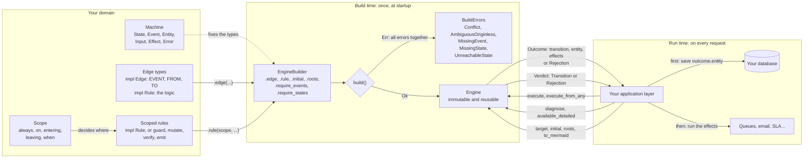
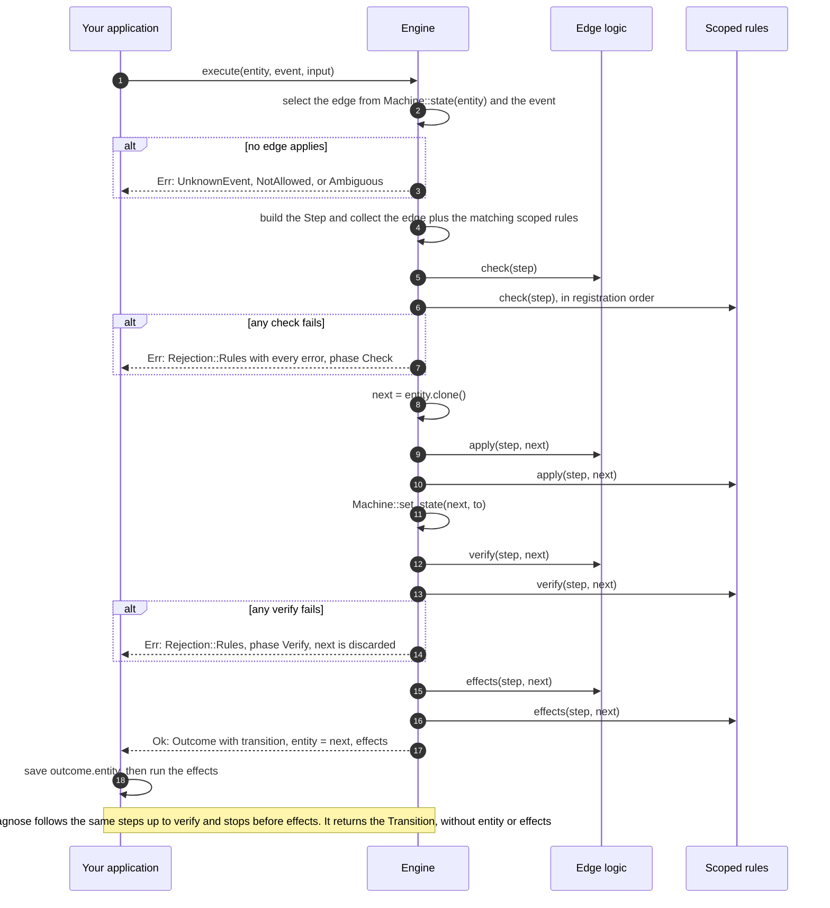
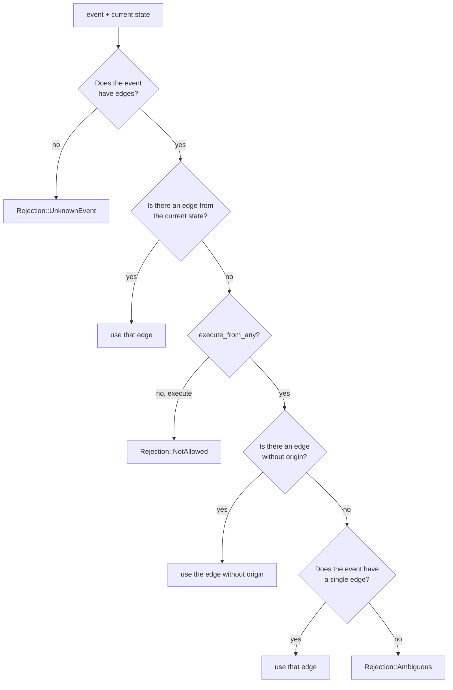

# fsm-forge

A generic state-machine engine for Rust. It knows nothing about your domain: you define
the states, the events, the entity, and the logic; the engine handles the topology,
execution order, validation, and diagnostics.

- No dependencies.
- No IO: it is pure and deterministic.
- Rules do not run effects: they **describe** them, and the engine returns them so you
  can run them after saving.
- The machine is validated at build time (`build()`), not in production.

It is the state kernel you embed in your service: the graph is declared in code and
validated at startup, and the engine returns the new entity plus the effects.
Persistence, transactions, running the effects, timers, and async runtimes stay in your
application.

## Installation

```sh
cargo add fsm-forge
```

Requires Rust 1.90 or later (edition 2024) and has no dependencies.

## Minimal example

The snippets in this README are illustrative. The runnable examples are
`examples/minimal/` (smallest) and `examples/ticket/` (largest):

```sh
cargo run --example invoice
cargo run --example ticket
cargo run --example ticket -- --mermaid
```

```rust
use fsm_forge::{Edge, Engine, Machine, Rule, Scope, Step, emit};

#[derive(Debug, Clone, Copy, PartialEq, Eq, Hash)]
enum Status { Draft, Issued }

#[derive(Debug, Clone, Copy, PartialEq, Eq, Hash)]
enum Event { Issue }

#[derive(Clone)]
struct Invoice { status: Status, total: i64 }

struct InvoiceMachine;

impl Machine for InvoiceMachine {
    type State = Status;
    type Event = Event;
    type Entity = Invoice;
    type Input = i64;           // what arrives with the event
    type Effect = &'static str; // what must run afterwards
    type Error = String;        // why it is rejected

    fn state(invoice: &Invoice) -> Status { invoice.status }
    fn set_state(invoice: &mut Invoice, status: Status) { invoice.status = status; }
}

struct Issue;

impl Edge<InvoiceMachine> for Issue {
    const EVENT: Event = Event::Issue;
    const FROM: &'static [Status] = &[Status::Draft];
    const TO: Status = Status::Issued;
}

impl Rule<InvoiceMachine> for Issue {
    fn check(&self, step: &Step<'_, InvoiceMachine>) -> Result<(), String> {
        if step.entity.total > 0 { Ok(()) } else { Err("total must be positive".into()) }
    }
}

fn main() -> Result<(), Box<dyn std::error::Error>> {
    let engine = Engine::<InvoiceMachine>::builder()
        .edge(Issue)
        .rule(Scope::always(), emit("audit", "audit"))
        .require_events([Event::Issue])
        .require_states([Status::Draft, Status::Issued])
        .build()?;

    let invoice = Invoice { status: Status::Draft, total: 100 };
    let outcome = engine.execute(&invoice, Event::Issue, &100)?;

    assert_eq!(outcome.transition.to, Status::Issued);
    Ok(())
}
```

## Architecture

The crate works in two moments. At **build time**, once at startup, you declare the
machine on an `EngineBuilder` and `build()` validates it. At **run time**, on every
request, your application asks the immutable `Engine` to execute or diagnose events, then
persists the result and runs the effects itself:



The engine never touches the database or the outside world: it receives an entity and
returns a new one plus a description of the work to do.

## Concepts

### Edges

An edge is a type: one type per transition. It implements two traits: `Edge`, with the
topology as constants, and `Rule`, with the logic as methods. Nothing is hidden in a
builder chain.

```rust
struct Issue;

impl Edge<InvoiceMachine> for Issue {
    const EVENT: Event = Event::Issue;
    const FROM: &'static [Status] = &[Status::Draft];
    const TO: Status = Status::Issued;
}

impl Rule<InvoiceMachine> for Issue {
    fn check(&self, step: &Step<'_, InvoiceMachine>) -> Result<(), String> { /* ... */ }
    fn apply(&self, step: &Step<'_, InvoiceMachine>, invoice: &mut Invoice) { /* ... */ }
    fn verify(&self, step: &Step<'_, InvoiceMachine>, invoice: &Invoice) -> Result<(), String> { /* ... */ }
    fn effects(&self, step: &Step<'_, InvoiceMachine>, invoice: &Invoice) -> Vec<&'static str> { /* ... */ }
}
```

Register it with `.edge(Issue)`. The constants describe the graph and the methods describe
the work:

| Piece     | Trait  | Meaning                                                                        |
| --------- | ------ | ------------------------------------------------------------------------------ |
| `EVENT`   | `Edge` | The event that triggers the edge.                                              |
| `FROM`    | `Edge` | Origin states. `&[]` makes the edge reachable only through `execute_from_any`. |
| `TO`      | `Edge` | Destination state.                                                             |
| `check`   | `Rule` | Precondition; `Err` rejects the transition.                                    |
| `apply`   | `Rule` | Change to the entity; the engine runs it on a copy.                            |
| `verify`  | `Rule` | Post-condition over the modified entity and the destination state.             |
| `effects` | `Rule` | Work the caller must run after persisting.                                     |
| `name`    | `Rule` | Label in diagnostics; defaults to the type name.                               |

Every `Rule` method is optional. An edge without logic still implements `Rule`, with an
empty block:

```rust
impl Rule<InvoiceMachine> for Archive {}
```

> **Register an edge with `.edge(...)`, never with `.rule(...)`.** Because an edge is a
> `Rule`, the compiler accepts it in both places, and `build()` does not report it either.
> In `.rule(scope, ...)` its logic runs on every transition the scope selects:
>
> ```rust
> .edge(SolutionConfirmed)                    // correct: only Resolved -> Closed
> .rule(Scope::always(), SolutionConfirmed)   // wrong: runs on every transition
> ```
>
> Its `check` would reject unrelated transitions, its `apply` would modify the entity on
> each of them, and its `effects` would be emitted everywhere. An `apply`-only edge is
> the hardest case to notice, because nothing fails.

- An event can have **several edges** if they leave from different states.
- The same `(event, origin)` **cannot** have two targets: `build()` reports it as
  `Conflict`.
- `FROM: &[A, B]` declares several origins.
- `FROM: &[]` declares an edge without origin: `execute` never selects it, only
  `execute_from_any` does.

The type may carry configuration in its fields; the engine uses the instance you pass to
`.edge(...)` on every execution:

```rust
struct InactivityTimeout {
    hours: u32,
}

impl Edge<TicketMachine> for InactivityTimeout {
    // EVENT, FROM, TO
}

impl Rule<TicketMachine> for InactivityTimeout {
    fn check(&self, step: &Step<'_, TicketMachine>) -> Result<(), &'static str> {
        expect(step.input.inactive_hours >= self.hours, "too early")
    }
}

.edge(InactivityTimeout { hours: 72 })
```

### Entry point

The engine does not create entities. Declare the states they are born in:

```rust
.initial(Status::Draft)                    // "state zero"
.roots([Status::Draft, Status::Imported])  // several legitimate entries
```

```rust
engine.initial(); // Option<State>: the first root
engine.roots();   // &[State]
```

This is **metadata**: it does not affect `execute`, `available`, or edge selection.

What it provides:

- `build()` checks that every state in the topology is reachable from some root and
  reports `UnreachableState` for the ones that are not.
- The diagram marks each root with `[*] --> State`.
- `engine.initial()` tells the application layer which state a new entity starts in.

What it **does not** do:

- It does not create entities or assign state: `execute` always reads the state the
  entity already carries.
- It does not restrict transitions: an entity in a non-initial state behaves the same.
- It does not force any entity to start there: it is a declaration, not a runtime
  guarantee.

Reachability validation only runs when roots are declared; without them,
"reachable" would have no definition. An edge without origin counts for reachability,
because `execute_from_any` can reach its target from any state. A root that appears in no
edge is valid.

If you need runtime behavior ("this may only run from the initial state"), that is a
domain rule with `check`, not an engine property.

### Rules

A `Rule` is logic without topology, and it runs in two places. Implemented on an `Edge`
type, it runs for that transition only. Registered with a `Scope`, it runs for every
transition the scope selects. Both go through the same pipeline; the engine runs the
edge's rule first, then every matching scoped rule in registration order.

| If the logic...                                               | Put it in                          |
| ------------------------------------------------------------- | ---------------------------------- |
| depends on the specific event, origin, or destination         | the `Rule` impl of the `Edge` type |
| applies to many transitions by event, state, or from-any mode | a standalone `Rule` + `Scope`      |
| describes work the caller must run after saving               | `effects`, in either of them       |

A `Rule` implements the methods it needs; all of them are optional:

| Method                      | When it runs                                      | Purpose             |
| --------------------------- | ------------------------------------------------- | ------------------- |
| `check(&step)`              | Before touching the entity                        | Precondition        |
| `apply(&step, &mut entity)` | On a copy of the entity                           | Changes             |
| `verify(&step, &next)`      | On the already modified entity with the new state | Postcondition       |
| `effects(&step, &next)`     | At the end, without mutating anything             | Describe later work |

`Step` is the context: `entity` (before the change), `event`, `from`, `to`, `input`, and
`from_any`. It includes `is_self_loop()`.

### Scopes

To avoid repeating a rule on every edge, register it once with a scope:

```rust
.rule(Scope::always(), PublishUpdate)
.rule(Scope::on(&[Event::Issue]), RequireNotes)
.rule(Scope::entering(&[Status::Issued]), SendInvoice)
.rule(Scope::leaving(&[Status::Issued]), CloseReceivable)
.rule(Scope::when(|step| step.from_any), OverrideAudit)
```

`entering` and `leaving` **exclude self-transitions**. If a rule must run on every
transition out of a state, a `State -> State` retry included, write the condition with
`Scope::when`:

```rust
.rule(Scope::when(|step| step.from == Status::Issued), AuditIssued)
```

### Large catalogs: sections

One type per transition keeps the catalog short: each line is a complete, named
transition, and the logic lives in its `impl`. With many edges, group them into
functions that take and return the builder:

```rust
fn creation(builder: EngineBuilder<ShipmentMachine>) -> EngineBuilder<ShipmentMachine> {
    builder.edge(NewDraft).edge(DraftConfirmed)
}

fn picking(builder: EngineBuilder<ShipmentMachine>) -> EngineBuilder<ShipmentMachine> {
    builder.edge(ToPickup).edge(DriverAssignedToPickup)
}

let engine = picking(creation(Engine::<ShipmentMachine>::builder()))
    .edge(...)
    .build()?;
```

`Edge` types are static: `EVENT`, `FROM`, and `TO` are constants, so one type maps to
one edge. When the same logic applies to several events, write it once as a standalone
`Rule` and register it with a scope:

```rust
struct RequireDriverId;

impl Rule<ShipmentMachine> for RequireDriverId {
    fn check(&self, step: &Step<'_, ShipmentMachine>) -> Result<(), &'static str> {
        /* ... */
    }
}

.rule(
    Scope::on(&[Ev::DriverAssignedToPickup, Ev::DriverReassignedToPickup]),
    RequireDriverId,
)
```

## How execution works

`execute(&entity, event, &input)` always follows the same order:

1. **Select the edge** for the event from the current state, or the from-any candidate
   when `execute_from_any` is used.
2. **Collect the rules**: first the edge's own logic (the `Rule` implemented on the
   edge type), then the global ones whose scope applies, in registration order.
3. **Run every `check`**. If any fails, reject with **all** errors together.
4. **Clone the entity**, run every `apply` in order, and move the state.
5. **Run every `verify`** on the resulting entity. If any fails, everything is discarded
   and there is no `Outcome`.
6. **Collect the `effects`** and return the `Outcome`.

The same order, as a sequence:



The original entity is never modified: if the execution is rejected, nothing changes.

> **`check` sees the previous entity, not the result.** All `check`s run before any
> `apply`, so a global rule that looks like an invariant does not protect the final
> state. That is what `verify` is for: it runs after mutating and after moving the state.
>
> **Assign the result.** `execute` returns the new entity in `Outcome::entity`; the
> engine does not mutate the original. If you forget `*entity = outcome.entity`, the
> transition was evaluated and the effects were produced, but your data did not change.

### Outcome

```rust
pub struct Outcome<M: Machine> {
    pub transition: Transition<M>,         // what ran (see below)
    pub entity: M::Entity,                 // ready to persist
    pub effects: Vec<AppliedEffect<M>>,    // effect + rule name
}

pub struct Transition<M: Machine> {
    pub event: M::Event,
    pub from: M::State,
    pub to: M::State,
    pub rules: Vec<&'static str>,          // which rules participated, in execution order
    pub from_any: bool,
}
```

`Transition` is what an execution and a diagnosis have in common: `execute` returns it
inside the `Outcome`, and `diagnose` returns it alone (see
[Querying without executing](#querying-without-executing)).

`effect_values()` returns only the effects, without the rule that produced them, and
`effects_of("name")` filters by rule. `outcome.transition.is_self_loop()` compares origin
and target.

To keep the entity in your variable, move it: `entity = outcome.entity;`. The other
fields stay readable afterwards, but methods such as `effect_values()` borrow the whole
`Outcome`, which is now partially moved, so call them before moving the entity:

```rust
let outcome = engine.execute(&invoice, Event::Issue, &100)?;
let effects: Vec<_> = outcome.effect_values().copied().collect(); // methods: before
invoice = outcome.entity;                                         // moves only the entity
let to = outcome.transition.to;                                   // fields: still readable
// outcome.effect_values()  // error[E0382]: borrow of partially moved value
```

If you prefer to keep the whole `Outcome` intact, clone the entity explicitly with
`entity = outcome.entity.clone()`; the cost stays visible at the call site.

## From-any mode

`execute_from_any(&entity, event, &input)` ignores the origin state, but it **runs all
rules**, including `check`. Edge selection follows these rules:

- If the event has an edge from the current state, that one is used.
- Otherwise, an **edge without origin** for the event is used ("from any state"). More
  than one edge without origin for the same event is rejected at build time with
  `AmbiguousOriginless`.
- Otherwise, the event's only edge is used. If it has several, it is rejected with
  `Ambiguous` instead of guessing.



An edge with `FROM: &[]` is only reachable this way: `execute` never selects it. Because
every rule still runs, the edge can reject a from-any execution explicitly:

```rust
impl Rule<TicketMachine> for SolutionConfirmed {
    fn check(&self, step: &Step<'_, TicketMachine>) -> Result<(), &'static str> {
        expect(!step.from_any, "this transition cannot be overridden")
    }
}
```

## Querying without executing

```rust
// Can this event run right now?
engine.diagnose(&entity, event, &input)?; // -> Transition

// Same, ignoring the origin state.
engine.diagnose_from_any(&entity, event, &input)?;

// Which events can run, and why not?
for (event, verdict) in engine.available_detailed(&entity, &input) { /* ... */ }
```

`diagnose` follows the same path as `execute`, so an `Ok` guarantees that `execute`
would also accept. It returns the same `Transition` that `execute` puts in
`Outcome::transition` (`event`, `from`, `to`, `rules`, `from_any`), without an entity or
effects.

```rust
pub type Verdict<M> = Result<Transition<M>, Rejection<M>>;
```

## Reading the topology

```rust
engine.target(Event::Issue, Status::Draft); // -> Option<Status>
```

`target` answers where an event goes from a given state according to the declaration,
without evaluating rules. Edges without origin have no `target`; they only run through
`execute_from_any`.

## Errors

### At execution: `Rejection<M>`

| Variant                       | When                                                                              |
| ----------------------------- | --------------------------------------------------------------------------------- |
| `UnknownEvent(event)`         | The event has no declared edges                                                   |
| `NotAllowed { event, from }`  | The event has edges, but none starts at the current state                         |
| `Ambiguous(event)`            | When overriding, the event has several edges and none starts at the current state |
| `Rules(Vec<AppliedError<M>>)` | One or more rules rejected; each error carries its rule and phase                 |

Each `AppliedError` includes:

```rust
pub struct AppliedError<M: Machine> {
    pub rule: &'static str,   // "perception_successful"
    pub phase: Phase,         // Check | Verify
    pub error: M::Error,
}
```

The `Display` message keeps everything:

```text
rejected by rules: available_tiles [check]: not enough movement
```

And you can keep only the errors with `rejection.rule_errors()`, or the full traceability
with `rejection.rules()`, which returns `Option<&[AppliedError<M>]>`
(`None` if the rejection did not come from rules).

`Rejection` and `BuildError` are `#[non_exhaustive]`: an external `match` needs a `_`
arm.

### At build time: `BuildErrors<M>`

`build()` accumulates **all** errors and returns them together:

| Variant                         | When                                                             |
| ------------------------------- | ---------------------------------------------------------------- |
| `Conflict { event, from }`      | Two edges for the same event leave the same state                |
| `MissingEvent(event)`           | An event in `require_events` has no edge                         |
| `MissingState(state)`           | A state in `require_states` appears in no edge and is not a root |
| `AmbiguousOriginless { event }` | More than one edge without origin for the same event             |
| `UnreachableState(state)`       | With roots declared, the state is not reachable from any of them |

## Diagram

```rust
let mermaid = engine.to_mermaid(); // stateDiagram-v2
```

The ids are the state's `Debug`; the labels come from `Machine::state_name` and
`Machine::event_name`. Edges without origin appear as a note on their target state.

## Guarantees

- **Pure**: no rule receives IO or an async runtime; everything it needs arrives in
  `Entity` or `Input`.
- **Deterministic**: given `(state, event)`, the target is fixed at build time. There is
  no target selection at runtime.
- **Atomic in memory**: if anything is rejected, the original entity is left untouched.
- **No dependencies**: `[dependencies]` is empty.
- **No `unsafe`**: enforced by a lint in `Cargo.toml`.

## Examples

The examples are ordered by difficulty. Each one is a directory with the same shape:

```text
examples/ticket/
  main.rs        entry point and application layer
  machine.rs     domain types, Machine impl, and engine assembly
  edges/         one file per transition
```

| Example      | Difficulty | One idea                                                                   |
| ------------ | ---------- | -------------------------------------------------------------------------- |
| `minimal`    | 1          | One edge, one event, execute and keep the result.                          |
| `invoice`    | 2          | Application layer: preload, execute, persist, dispatch.                    |
| `initial`    | 3          | Topology: entry points, roots, and reachability errors.                    |
| `conditions` | 4          | `check` / `apply` / `verify`, rejection, `diagnose`, `available_detailed`. |
| `ticket`     | 5          | Full lifecycle with 14 edges, scopes, effects, and a from-any execution.   |

```sh
cargo run --example minimal
cargo run --example invoice
cargo run --example initial
cargo run --example conditions
cargo run --example ticket
cargo run --example ticket -- --mermaid
```

The `initial` example builds several engines inside `main.rs` on purpose: it
demonstrates the entry points and the build errors, not a single lifecycle.

## Tests

The integration suite covers the engine from the simplest topology to the full ticket
lifecycle:

| File               | Coverage                                                                                                  |
| ------------------ | --------------------------------------------------------------------------------------------------------- |
| `tests/basic.rs`   | Door and traffic light: simple edges, self-loops, several origins, from-any mode, Mermaid.                |
| `tests/rules.rs`   | Invoice: checks, mutations, verify failures, effects, phases, `diagnose` without effects, outcome result. |
| `tests/scopes.rs`  | Article: all five `Scope`s, self-loop boundaries, from-any scope, registration order.                     |
| `tests/builder.rs` | Shipment: conflicts, missing events and states, ambiguous edges without origin, reachability, roots.      |
| `tests/ticket.rs`  | Full support-ticket lifecycle: creation, assignment, waiting, reopen, timeout, supervisor override.       |

Run them with `cargo test`.

## Crate map

The `prelude` gathers the types (`Engine`, `Machine`, `Edge`, `Rejection`, ...).
The helpers are imported from the crate root: `use fsm_forge::{guard, mutate, verify, emit};`.

| File             | Contents                                              |
| ---------------- | ----------------------------------------------------- |
| `src/lib.rs`     | Public surface, crate docs, and `prelude`             |
| `src/machine.rs` | `Machine`: the domain contract                        |
| `src/rule.rs`    | `Rule`, `Step`, `Scope`, `NamedRule`: logic and scope |
| `src/edge.rs`    | `Edge` trait and the compiled edge used by the engine |
| `src/engine.rs`  | `Engine`: execute, diagnose, and query                |
| `src/builder.rs` | `EngineBuilder`: declare and validate                 |
| `src/outcome.rs` | `Outcome`, `Transition`, `AppliedEffect`, `Verdict`   |
| `src/error.rs`   | `Rejection`, `BuildError`, `BuildErrors`: what failed |
| `src/mermaid.rs` | `to_mermaid`: the diagram                             |

## Running the checks

```sh
cargo test
cargo clippy --all-targets -- -D warnings
RUSTDOCFLAGS="-D warnings" cargo doc --no-deps
```

## License

MIT. See [LICENSE](LICENSE).
